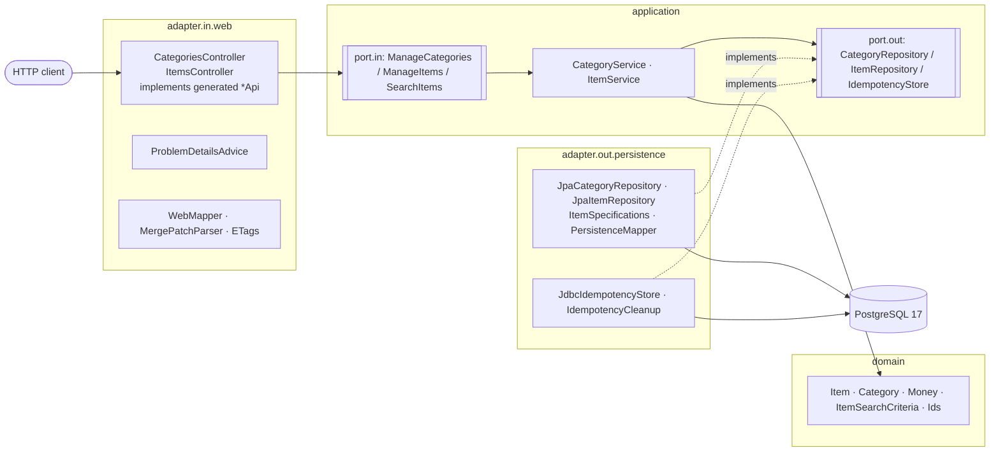

# Архитектура — 02-rest-service

## Слои (гексагональная архитектура)

- Домен — только JDK (ArchUnit). JPA-сущности, Spring Data и SQL живут в `adapter.out.persistence`.
- Сгенерированный API (`adapter.in.web.api`, `target/generated-sources`) виден только веб-адаптеру (ArchUnit).
- Нарушения ограничений БД переводятся в доменные исключения внутри адаптера **по имени ограничения**
  (`item_category_fk`, `category_name_ci`); прочие нарушения — ошибка программы и остаются `500`.

## Сквозные механизмы

| Механизм | Где | Суть |
|---|---|---|
| Contract-first | `static/catalog-api.yaml` → openapi-generator | интерфейсы + DTO; ответы проверяет `CatalogScenarioIT` |
| Problem Details | `ProblemDetailsAdvice` | RFC 9457, `type` = `https://hephaestus.ibikus.de/problems/<slug>`; неожиданные ошибки — `500 internal-error` без деталей |
| Идемпотентность | `ItemService` + `idempotency_key` | ключ и изделие в одной транзакции; повтор отдаёт изделие; очистка раз в час |
| Оптимистическая блокировка | `ETags`, `ItemService`, `@Version` | `If-Match` → `428`/`412`; гонка в БД → `412` |
| Версия API | `spring.mvc.apiversion.*` | заголовок `API-Version`, поддерживается `1` |

## Схема данных (Flyway)

| Миграция | Таблица | Ключевое |
|---|---|---|
| `V1__category.sql` | `category` | уникальность имени без учёта регистра (`lower(name)`) |
| `V2__item.sql` | `item` | `price_amount numeric(12,2) >= 0`, FK на `category`, индексы `category_id`, `price_amount` |
| `V3__idempotency_key.sql` | `idempotency_key` | первая версия: копия ответа POST (заменена в V4) |
| `V4__idempotency_key_item.sql` | `idempotency_key` | ключ → хэш запроса + `item_id`, индекс `created_at` для очистки |

Hibernate работает в режиме `validate`: схему меняет только Flyway.
