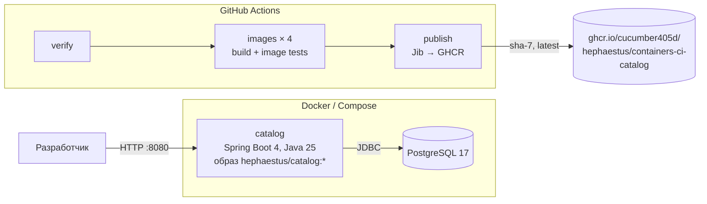

# Architecture — 03-containers-ci

## C4: контейнеры

Сервис — облегчённый Catalog: гексагональная структура (`domain` / `application` / `adapter.in.web`,
`adapter.in.actuator` / `adapter.out.persistence`), правила проверяет ArchUnit. Вся конфигурация — env vars.

## Слои образов

| | Buildpacks | Jib | Dockerfile | Dockerfile.jlink |
|---|---|---|---|---|
| Нужен Docker-демон | да | нет (`jib:build`) | да | да |
| Описание образа | конфигурация плагина | конфигурация плагина | Dockerfile | Dockerfile |
| Запуск | launcher Paketo → `java` | `java -cp … MainClass` | `JarLauncher` | `JarLauncher` |
| Флаги памяти | memory calculator | `MaxRAMPercentage=75` | `MaxRAMPercentage=75` | `MaxRAMPercentage=75` |
| Shell в образе | нет | да (Ubuntu) | да (Ubuntu) | да (Debian slim) |

## Ключевые решения

Подробно — в [спецификации](superpowers/specs/2026-11-13-03-containers-ci-design.md), раздел 2:
облегчённый сервис; все способы в одном модуле; Jib — канонический образ; образные тесты в профиле `image-it`;
свои ожидания лимитов для Buildpacks; публикация отдельным reusable-workflow после образных тестов.
