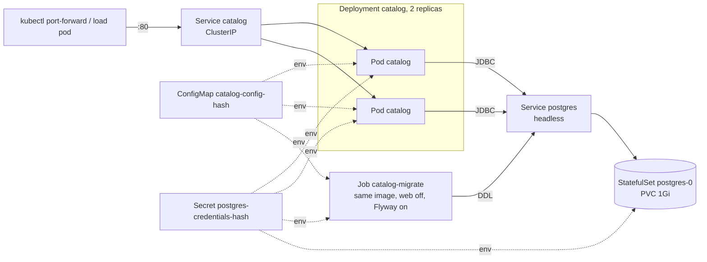
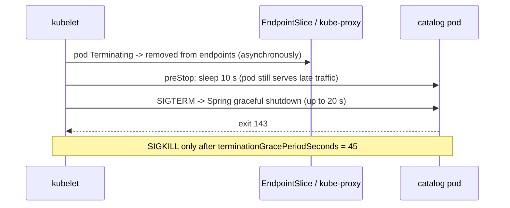

# Architecture — 04-k8s-basics



Namespace `hephaestus-04`. Образ `ghcr.io/cucumber405d/hephaestus/containers-ci-catalog:sha-d730159`.

## Порядок деплоя (`scripts/deploy.sh`)

```mermaid
sequenceDiagram
    participant D as deploy.sh
    participant K as API server
    D->>K: apply component in (namespace, config, database)
    D->>K: rollout status statefulset/postgres
    D->>K: delete job catalog-migrate; apply component=migration
    loop until succeeded / failed
        D->>K: get job status
    end
    D->>K: apply component=api
    D->>K: rollout status deployment/catalog
```

## Жизнь пода при удалении (rollout, scale down)



Решения и альтернативы — в [спецификации](superpowers/specs/2026-11-16-04-k8s-basics-design.md), раздел 2.
