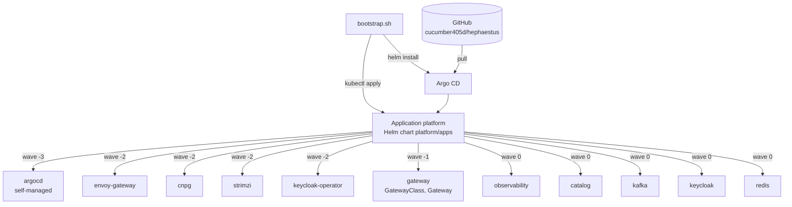
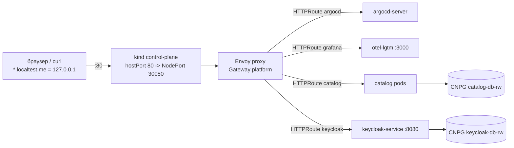

# Architecture — 05-platform-gitops

## Bootstrap и App-of-Apps

Профиль `minimal`: argocd, envoy-gateway, gateway, cnpg, observability, catalog. `full`: все.

## Трафик

## Catalog: порядок через волны

| Волна | Объект | Argo CD ждёт |
|---|---|---|
| 0 | `Cluster catalog-db` (CNPG) | health «Cluster in healthy state» |
| 1 | `Job catalog-migrate` — Sync hook, `BeforeHookCreation` | Job complete |
| 2 | Deployment, Service, HTTPRoute | rollout, readiness |

## Где что живёт

| Namespace | Содержимое |
|---|---|
| `argocd` | Argo CD, Application, HTTPRoute argocd |
| `envoy-gateway-system` | контроллер Envoy Gateway, EnvoyProxy, Gateway, прокси Envoy |
| `cnpg-system`, `strimzi`, `keycloak` | операторы |
| `observability` | otel-lgtm |
| `catalog` | catalog-db, Job, API |
| `kafka`, `keycloak`, `redis` | Kafka `platform`, Keycloak + keycloak-db, Redis |

Решения и альтернативы — [спецификация](superpowers/specs/2026-11-16-05-platform-gitops-design.md), раздел 2.
