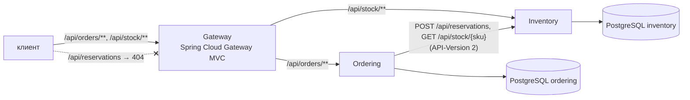
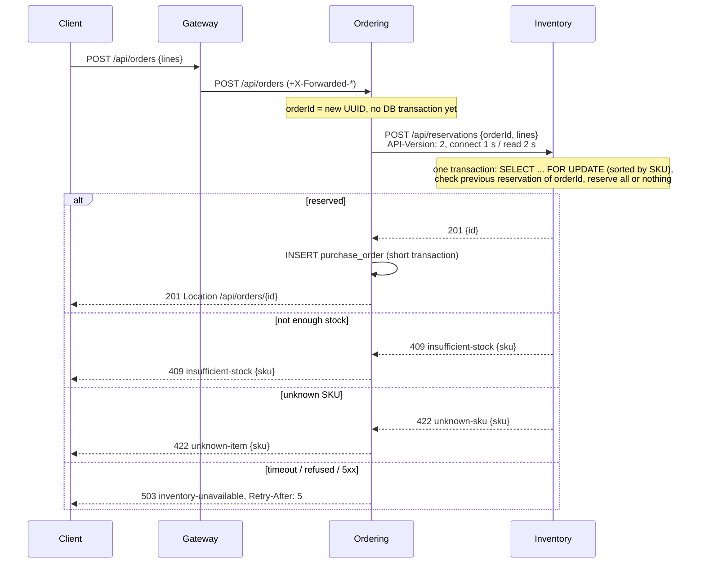

# Architecture — 06-service-communication

## Размещение заказа

## Два входа на платформе

`http://shop.localtest.me` → **Envoy** (Gateway API платформы: хосты, TLS в 21, одна точка входа кластера) →
**Spring Cloud Gateway** (прикладной вход магазина: какие пути публичны, позже — токены и BFF в 07) →
сервисы по DNS Service (`http://ordering`, `http://inventory`).

Решения и альтернативы — [спецификация](superpowers/specs/2026-11-17-06-service-communication-design.md), раздел 2.
