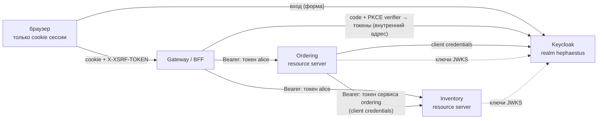

# Architecture — 07-security



## Вход (Authorization Code + PKCE, BFF)

```mermaid
sequenceDiagram
    participant B as Browser
    participant G as Gateway (BFF)
    participant K as Keycloak
    B->>G: GET /me (без сессии)
    G-->>B: 302 /oauth2/authorization/keycloak
    B->>G: GET /oauth2/authorization/keycloak
    Note over G: state, nonce, code_verifier → в сессию<br/>code_challenge = BASE64URL(SHA256(verifier))
    G-->>B: 302 K/auth?client_id=shop-gateway&code_challenge=…&code_challenge_method=S256
    B->>K: форма логина, alice/alice
    K-->>B: 302 G/login/oauth2/code/keycloak?code=…&state=…
    B->>G: GET …?code&state
    G->>K: POST /token code + code_verifier + client secret (внутренний адрес)
    K-->>G: access token (aud ordering, inventory), refresh token, ID token
    Note over G: ID token: подпись, iss, aud, nonce; новая сессия (fixation)
    G-->>B: 302 / + Set-Cookie JSESSIONID (HttpOnly, SameSite=Lax)
    B->>G: GET /me → XSRF-TOKEN cookie
```

## Заказ

```mermaid
sequenceDiagram
    participant B as Browser
    participant G as Gateway
    participant O as Ordering
    participant K as Keycloak
    participant I as Inventory
    B->>G: POST /api/orders, cookie + X-XSRF-TOKEN
    Note over G: CSRF ok; токен из сессии (refresh, если истёк)
    G->>O: POST /api/orders, Authorization: Bearer (alice), без Cookie
    Note over O: JWT: подпись (JWKS), iss, aud ∋ ordering, ROLE_customer
    O->>K: client_credentials ordering (кэш до истечения)
    O->>I: POST /api/reservations, Bearer (service-account-ordering)
    Note over I: JWT: aud ∋ inventory, ROLE_inventory-reserver
    I-->>O: 201
    Note over O: customer_id = sub alice
    O-->>G: 201
    G-->>B: 201
```

## Адреса Keycloak

| | Compose | Kubernetes |
|---|---|---|
| публичный (браузер, `iss` токенов) | `http://localhost:8180` | `http://keycloak.localtest.me` |
| внутренний (ключи, токены) | `http://keycloak:8080` | `http://keycloak-service.keycloak:8080` |

Keycloak с `hostname` = публичный адрес и `backchannel-dynamic` выдаёт токены с публичным `iss`, даже если
запрос пришёл на внутренний адрес. Сервисы сравнивают `iss` со строкой, а ключи берут по внутреннему URL —
без discovery на публичный адрес, недоступный из контейнера.

## Сеть в кластере

Namespace `hephaestus-07`: всё входящее запрещено (`default-deny-ingress`), разрешено только
Envoy → gateway → ordering → inventory, gateway → inventory, сервис/Job миграции → своя БД, оператор CNPG → БД,
пробы kubelet (адреса узлов kind). Исходящий трафик не ограничен.

Решения и альтернативы — [спецификация](superpowers/specs/2026-11-17-07-security-design.md).
