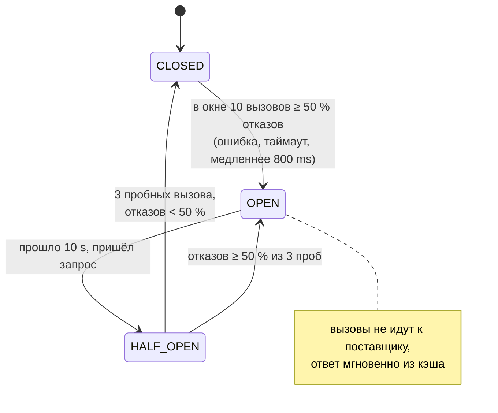

# Architecture — 08-resilience

```mermaid
flowchart LR
    client[клиент] -->|"/api/supply/{r4j|sccb|spring}/{sku}"| ctl[SupplyController]
    ctl --> svc[SupplyService<br/>кэш и fallback]
    svc --> a1[Resilience4j<br/>RL → bulkhead → retry → CB]
    svc --> a2[Spring Cloud CB<br/>CB + time limiter]
    svc --> a3[Spring 7<br/>@Retryable + @ConcurrencyLimit]
    a1 & a2 & a3 --> call[SupplierCall<br/>HTTP: connect 500 ms, read 1 s<br/>404 → UnknownOffer]
    call --> toxi[Toxiproxy :8666<br/>latency, reset_peer]
    toxi --> sup[Supplier<br/>/admin/faults, /admin/stats]
    svc <--> redis[(Redis<br/>offer:{sku}, 10 мин)]
```

Защита общая по числам (`supply.*` в `application.yaml`), отличается механизмом. Fallback — один, в
`SupplyService`: живой ответ кладётся в Redis; `SupplierUnavailableException` → последний известный ответ
(`source: cache`, `fetchedAt` — когда он был живым) или 503 `supplier-unavailable` + `Retry-After`.

## Circuit breaker



404 поставщика — ответ, а не отказ: не ретраится и не попадает в окно breaker'а.

## Порядок защит Resilience4j (снаружи внутрь)

`RateLimiter(20/s)` → `Bulkhead(10, без ожидания)` → `Retry(3, 200 ms ±50 %, затем 400 ms ±50 %)` → `CircuitBreaker` на каждую
попытку → HTTP-вызов с таймаутами. Открытый breaker отвечает `CallNotPermittedException`, retry его не повторяет.
Bulkhead стоит снаружи retry: запрос держит слот и во время пауз между попытками (до ~3,6 s) — так он ограничивает
и наши собственные повторы, а не только одновременные вызовы.

Решения и альтернативы — [спецификация](superpowers/specs/2026-11-18-08-resilience-design.md).
