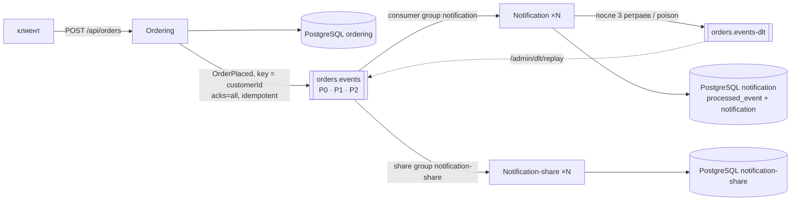

# Architecture — 09-events-kafka



## Обработка события (consumer group)

```mermaid
sequenceDiagram
    participant K as Kafka
    participant L as Listener
    participant DB as PostgreSQL
    participant D as DLT
    K->>L: OrderPlaced (partition p, offset o)
    L->>L: JSON → OrderPlaced (иначе InvalidEventException)
    L->>DB: BEGIN; insert processed_event(event_id) on conflict do nothing
    alt новое событие
        L->>DB: insert notification; COMMIT
    else уже обработано
        L->>DB: COMMIT (ничего) — дубль пропущен
    end
    L->>K: commit offset o+1
    Note over L: ошибка → повтор через 1 s, 2 s, 4 s → запись в DLT, commit, дальше
    Note over L: InvalidEventException → сразу в DLT
```

## Где dual write

Ordering: `INSERT purchase_order` (commit) → `send(OrderPlaced)`. Если Kafka не подтвердила — клиент получает
503, но заказ сохранён, а события нет. Обратное (событие есть, заказа нет) невозможно — порядок «сначала БД».
Тема 10 закрывает дыру outbox-таблицей в той же транзакции, что и заказ.

Решения и альтернативы — [спецификация](superpowers/specs/2026-11-18-09-events-kafka-design.md).
