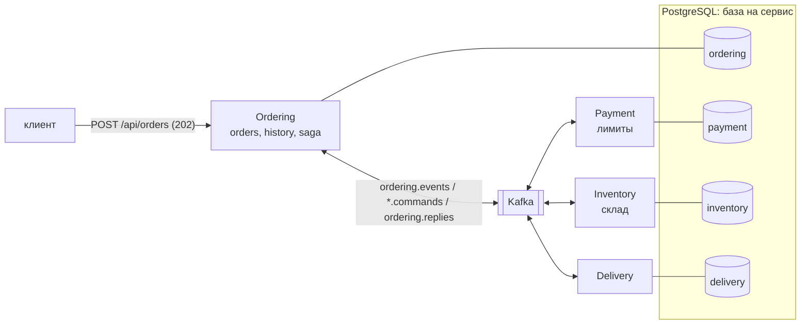
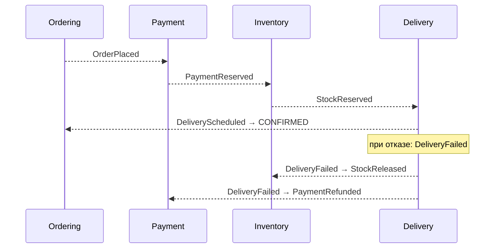
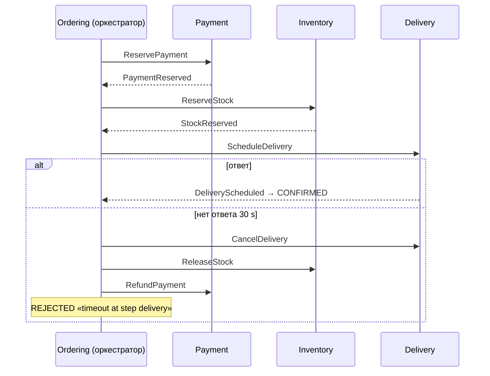

# Architecture — 10-outbox-saga



## Outbox (в каждом сервисе)

```mermaid
sequenceDiagram
    participant S as Сервис
    participant DB as Своя БД
    participant M as Spring Modulith
    participant K as Kafka
    S->>DB: BEGIN; изменение состояния
    S->>M: publishEvent(OutgoingMessage)
    M->>DB: insert event_publication
    S->>DB: COMMIT (оба или ничего)
    M->>K: send(topic, key = orderId) после коммита
    alt Kafka ответила
        M->>DB: completion_date = now
    else Kafka лежит
        Note over M,DB: публикация остаётся незавершённой;<br/>переотправка раз в 10 s
    end
```

## Хореография



## Оркестрация



Решения и альтернативы — [спецификация](superpowers/specs/2026-11-18-10-outbox-saga-design.md).
