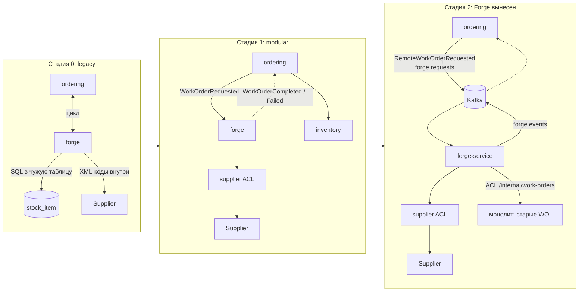
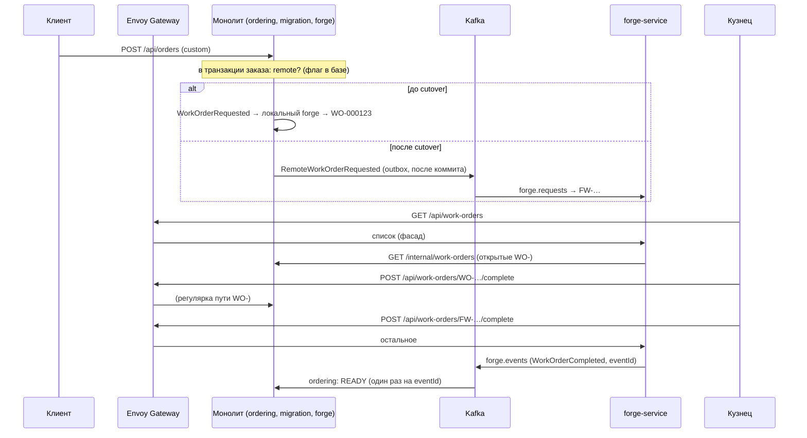

# 13 — архитектура

## Три стадии

Сплошные стрелки — зависимости кода; пунктир — события. На стадии 1 все типы событий лежат в API `forge`, поэтому
зависимость одна: ordering → forge (ADR-0010).

## Переключение (вариант A, ADR-0009)

## Где что живёт

| | Монолит (`modular`) | `forge-service` |
|---|---|---|
| База | `workshop`: схемы `ordering`, `inventory`, `forge`, `migration` | `forge`: `work_order`, `material` |
| Id заказов на ковку | `WO-000123` (последовательность) | `FW-<uuid>` |
| Склад материалов | своя доля — для старых заказов | своя доля, заполняется при развёртывании |
| Проверка структуры | Spring Modulith `verify()` | ArchUnit (гексагон, как 02) |
| ACL к поставщику | модуль `supplier` | `adapter.out.supplier` (копия) |
