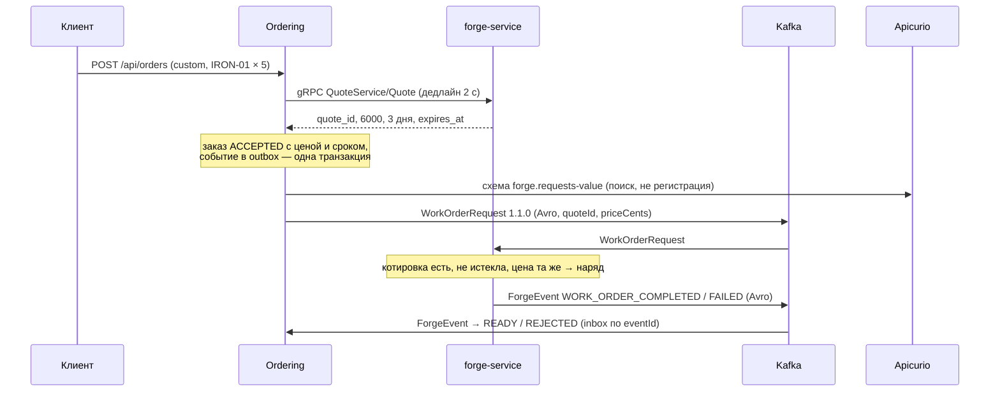

# 14 — архитектура

## Потоки

Без котировки (Forge молчит дольше 2 с, неизвестный материал, количество < 1) заказ сразу `REJECTED` с причиной,
в Kafka ничего не уходит.

## Где живут контракты

`contracts/` — Maven-модуль со своей версией (1.1.0). Из `.proto` и `.avsc` генерируется Java; оба сервиса
зависят от **зафиксированной** версии (`contracts.version` в своём POM), а не от последней в сборке. Ручных копий
типов сообщений в сервисах нет. Внутри подпроекта общий модуль допустим: правило «нет общих библиотек» действует
между подпроектами.

| Файл | Что | Проверка |
|---|---|---|
| `src/main/proto/.../quote.proto` | `QuoteService/Quote` | `buf breaking` против `released/1.0.0/proto` |
| `src/main/avro/work_order_request.avsc` | `forge.requests` | `SchemaCompatibilityIT`: BACKWARD к 1.0.0 |
| `src/main/avro/forge_event.avsc` | `forge.events` | то же |
| `asyncapi.yaml` | оба топика, payload — `$ref` на `.avsc` | AsyncAPI CLI |
| `../pacts/ordering-forge-service-quote.json` | что Ordering читает из котировки | `QuotePactProviderTest` |

## Версии и порядок выкатки

- **1.0.0** — запрос без котировки (Ordering ещё не знает про цену). **1.1.0** — `quoteId`, `priceCents`,
  опциональные с `default: null`.
- Правило `BACKWARD`: новая схема читает данные старой. Значит, первым обновляется **потребитель** топика:
  forge-service на 1.1.0 читает и сообщения 1.0.0 (`WorkOrderIntakeIT.v1RequestWithoutQuoteIsAccepted`) — запрос
  без котировки принимается, как в 13. Затем Ordering начинает слать 1.1.0.
- Схемы регистрирует пайплайн (CI, в compose — `schema-init`), сервисы — никогда (`auto-register: false`). Схема,
  которую реестр отверг, не доедет до продюсера: он её не найдёт.

## Outbox

Как в 13, событие публикуется в транзакции заказа и хранится в реестре публикаций Spring Modulith. Но вместо
`@Externalized` — свой relay (`RequestRelay`, `OutcomeRelay`): после коммита он строит Avro-объект и отправляет его,
дожидаясь подтверждения брокера. Иначе сгенерированный Avro-класс попал бы в JSON реестра публикаций.

## Ошибки

`ErrorHandlingDeserializer` вокруг Avro-десериализатора Apicurio: байты, которые не читаются, сразу уходят в
`<topic>.DLT` в исходном виде; временные ошибки — экспоненциальная пауза до `KAFKA_RETRY_MAX_ELAPSED`, как в 13.
