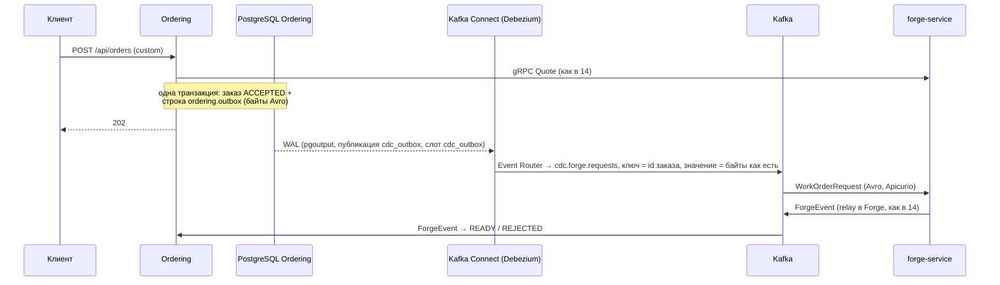

# 15 — архитектура

## Поток (режим debezium)

## Почему байты, а не JSON

Ordering сериализует запрос тем же `AvroKafkaSerializer`, с той же конфигурацией продюсера, что relay из 14 (явная
версия схемы, id схемы в теле — `headers.enabled=false`). Connect не конвертирует: `ByteArrayConverter`.
Схемами по-прежнему владеет пайплайн, Forge и pact-файл не менялись. Цена: Ordering ходит в реестр внутри
транзакции заказа — реестр недоступен → 503 (ADR-0016).

## Режимы

`OUTBOX_MODE` читается при старте. `debezium`: `OutboxWriter` (синхронный слушатель, та же транзакция),
`OutboxCleanup` (строки старше `OUTBOX_RETENTION`, 1 ч — только чтобы на них посмотреть). `modulith`:
`RequestRelay` из 14, outbox не пишется — иначе работающий коннектор доставил бы дважды.

## Гарантии

At-least-once: Connect коммитит offset периодически; убитый до коммита, он отправит повторно (учение 4). Forge
идемпотентен по id заказа (одна запись на заказ), Ordering — по `eventId` (inbox), как в 13.

## Платформа

| Ресурс | Где | Зачем |
|---|---|---|
| CNPG `ordering-db` | `wal_level: logical`, `max_slot_wal_keep_size: 512MB`, managed role `cdc` (REPLICATION) | логическое декодирование, предел для забытого слота |
| `KafkaConnect cdc-connect` | образ `connect/Dockerfile` (Strimzi Kafka 4.3.1 + Debezium) | рабочий Connect, `use-connector-resources` |
| `KafkaConnector ordering-outbox` | те же настройки, что `connect/ordering-outbox.json` | коннектор — ресурс в git |
| Apicurio + Job `schema-init` | `hephaestus-15`, in-memory | реестра в платформе нет |
| `KafkaTopic cdc-forge-*` | namespace kafka | не пересекаться с JSON-топиками 13 |

Пароль `cdc` — обычный Secret (учебный кластер); `KubernetesSecretConfigProvider` Strimzi подставляет его в
коннектор, Role даёт Connect право прочитать только этот секрет.
