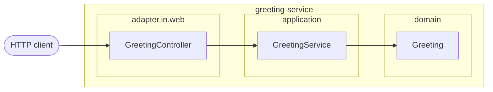

# Архитектура — _template

- Зависимости направлены внутрь; `domain` не знает Spring. Проверяется `HexagonalArchitectureTest`.
- Ошибки — RFC 9457 Problem Details (`application/problem+json`).
- Virtual threads, graceful shutdown, liveness/readiness probes, ECS-JSON логи в stdout.
